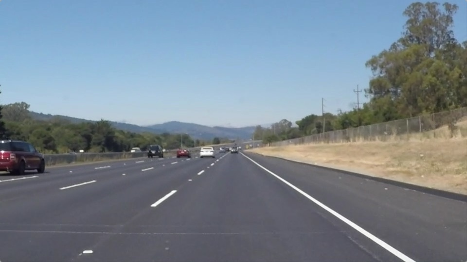
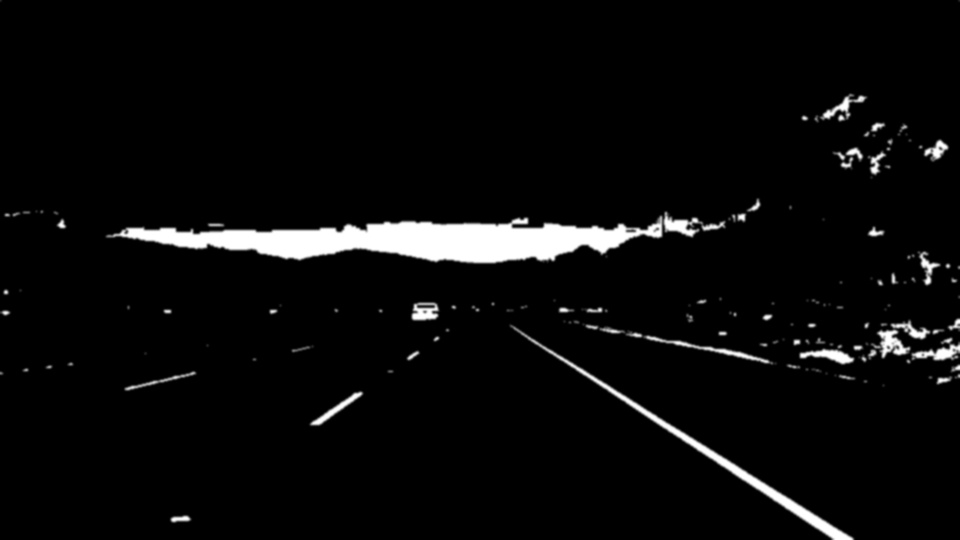
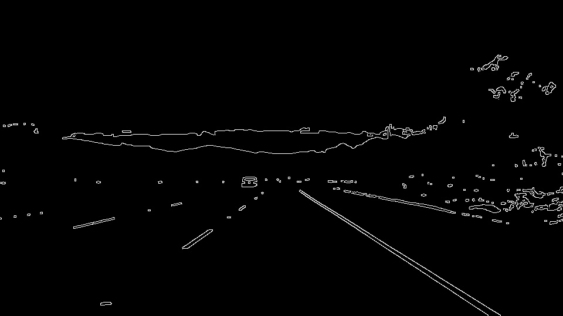
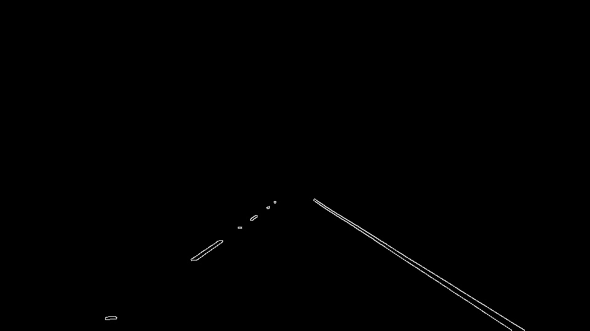

# Classical Computer Vision: Lane Line Extractor

This project is a lane line detection pipeline built with Python, OpenCV, and NumPy. It processes static road images from a vehicle's perspective to isolate highway lane markings using classical computer vision techniques.

---

## Processing Pipeline

The pipeline processes each road image through five sequential stages:

1. **Image Loading (`load_image`)**: Reads images in BGR format from the `test_images/` directory.
2. **HSV Color Filtering (`filter_colors`)**: Converts BGR to HSV color space and isolates yellow and white paint markings using threshold masks, ignoring ambient asphalt lighting and shadows.
3. **Gaussian Smoothing (`apply_blur`)**: Softens the mask using a 5x5 Gaussian kernel to suppress fine gravel texture and high-frequency noise.
4. **Canny Edge Detection (`detect_edges`)**: Traces sharp intensity boundaries into thin 1-pixel-wide line contours using dual-threshold hysteresis.
5. **Region of Interest (ROI) Masking (`apply_roi`)**: Applies a dynamic trapezoidal mask to focus exclusively on the road corridor, eliminating extraneous edges from the sky, trees, and horizon.

---

## Pipeline Demonstration

Below are the intermediate outputs generated for `solidWhiteRight.jpg`:

### 1. Original Road Image


### 2. HSV Color Mask (White & Yellow Isolated)


### 3. Gaussian Blurred


### 4. Canny Edge Detection


### 5. Final Extracted Lane Lines (ROI Masked)


---

## Requirements & Setup

- Python 3.10+
- OpenCV (`opencv-python`)
- NumPy

### Installation

```bash
pip install opencv-python numpy
```

---

## How to Run

1. Place one or more test images inside the `test_images/` directory.
2. Run the extractor script:

```bash
python lane_extractor.py
```

3. An interactive window will display each processed image sequentially. Press any key (or Enter) on the image window to proceed to the next image. All intermediate and final stages will automatically be saved into the `outputs/` folder.